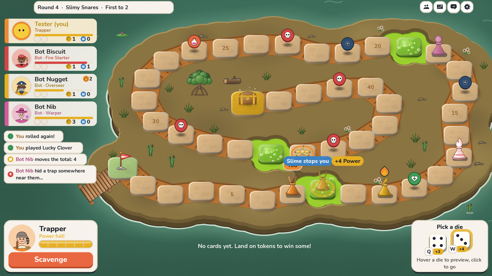
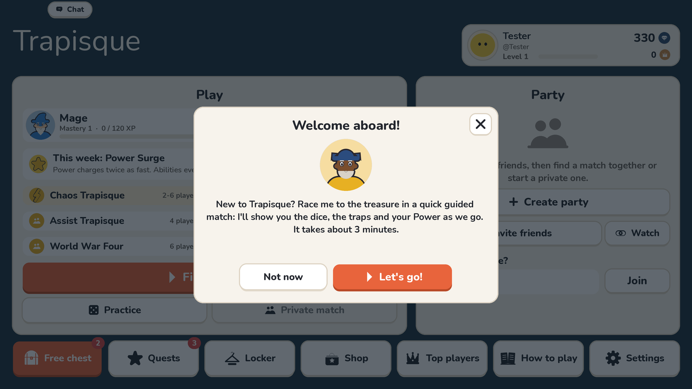
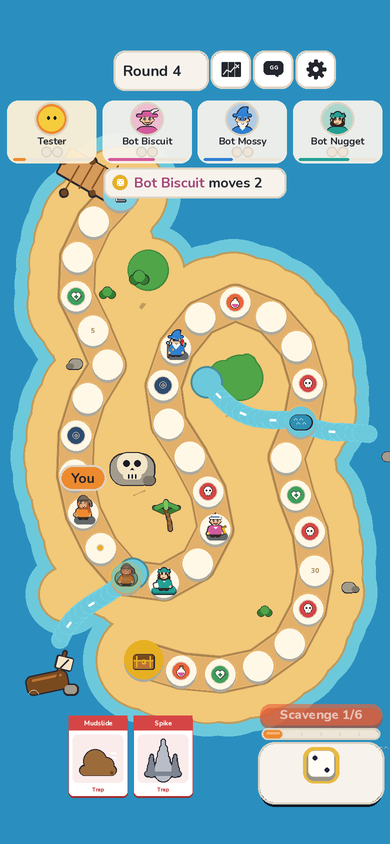

# Trapisque

Trapisque is a race to the treasure across a trap-filled board, for 2 to 6 players. It
started as a board game, and this repository is its Roblox version: a purely top-down
2D game that uses the Roblox engine but doesn't look like a Roblox game. There is no 3D
world. Each player is a playing piece on the board, like a set of chess pieces in
their character's colour. The board is seen a little from the side, like the pieces:
the ground is foreshortened, the props and the pieces stand up on it, each map is a
slab of land with a cliff along the edges that face you and foam where it meets the sea,
the tiles are low stones, and the trail is worn into the ground. What's on a tile is
drawn as the thing itself (a banana peel lying on it, spikes, a wall, the tile frozen
over), not as an icon. The pieces, the props and landmarks on the maps, what's on the
tiles, the stones' faces, the little things lying about, the Kraken's animation frames,
the characters' emblems and the cards' badges are illustrations (drawn in [art/](art),
built into image sheets the game makes itself). Everything else is built from plain UI
frames, in one calm tabletop look: flat colours with light borders, one rounded font in
sentence case, one orange accent for the main action on a screen. The characters have no
faces: each is an emblem, a badge with a symbol of theirs (the Mage's snowflake, the
Trapper's bear trap, the Fire Starter's flame...), and every card is a badge in its
category's colour in the same style.

| Match (PC) | Lobby (PC) | Match (upright phone) |
| --- | --- | --- |
|  |  |  |

More in [docs/previews](docs/previews): the maps, the character picker, the
locker, results, and phones held both ways. They're real screenshots of the game,
rendered offline (see [Screenshots](#screenshots)).

## What's in the game

- **Turns you play, not watch.** Your two dice are rolled for you and you pick which
  one to move with; the other one charges your Power bar. Hover a die and the board
  shows exactly where it takes you and what happens there. Roll doubles and the second
  die takes you backwards instead (or move the total). Whoever is clearly last (laps
  count) rolls an extra gold die that only moves.
- **Hidden traps.** Trap cards hide near you where only your team can see them. Guess
  where rivals will land; when one steps on yours: GOTCHA! (coins and Power for you).
- **Bonks.** Land on a rival and they fly back 2 tiles. BOING.
- **Eight characters, all fair.** Mage, Trapper, Fire Starter and Naturalist are free;
  Warper, Overseer, Gambler and Cannoneer unlock at levels 3, 5, 7 and 10. Each has a
  passive and a Power ability, tuned with thousands of bot games per map so each one
  wins about as often as the others (see [docs/DESIGN.md](docs/DESIGN.md)).
- **Cards you plan around.** One card per turn: traps, boosts that change which tiles
  you can reach, a Compass that sets a die to any number, board pieces (teleporters,
  the original game's Shifting Sands, conveyor belts) and potions from the Potion
  Seller (a Thief Potion steals a card from a rival).
- **Eight maps**, each a place the trail winds through: Blissful Tricks (a tropical
  island cut by two rivers), Junction Dungeon (a rocky sea fortress with locked gates
  and secret tunnels for its shortcuts), Slimy Snares (a swamp boardwalk spiralling
  in to the treasure, past slime pools), Haunted Hollow (a graveyard where two ghosts
  drift back along the trail every round and scare anyone they meet), Mount Kaboom
  (a volcano that erupts every third round, scorching anyone standing in its lava
  streams), Frostbite Floes (ice floes whose thin ice cracks under one player and
  gives way under the next), Kraken's Reach (an atoll round the Kraken's whirlpool,
  where it watches from the middle of the lagoon and its arm rises out of the water
  ahead of the leader, then slams down and drags whoever it hits back) and Clockwork
  Cove (a tinkerer's harbour with two drawbridges that go up in turns, and two cogs
  that swing you forward or back). Each has its own hazard, and its own card
  that shrugs it off (the Lantern, the Fire Cloak, the Harpoon...). **Six modes**: Chaos (free-for-all), **Blitz** (first treasure
  wins, 30-second turns), Assist (2 vs 2), Factions (three teams of 2), World War Four
  (3 vs 3) and a **Weekly Event** with a twist on the rules (Trap Frenzy, Bonk
  Bonanza, Power Surge, Triple Dice). See [docs/RULES.md](docs/RULES.md) for the rules
  as played.
- **A guided first match.** New players are offered a short Blitz game against gentle
  bots, with the Overseer pointing at the dice, the cards and the ability as each one
  comes up (scripted for a first win, and 100 Gems). It's in How to Play any time.
- **Something to do between turns.** A fishing rod in the board's corner: cast, watch
  the shadow under the bobber (how big it is), leave the nibbles alone and tap fast on
  the real bite. Every map has its own fish (three each, plus a few found anywhere and
  the Golden Fish); the fish log keeps your biggest of each and shows where each one
  lives. Now and then you land a coin for the match.
- **Rematch.** The results screen has a Rematch button: once everyone still at the
  table asks, the same players go again on the same map, straight away.
- **Watch a friend.** Friends in a match show up under WATCH in the party panel; you
  see the board the way every player does (no one's hand, no hidden traps).
- **Badges.** Twenty Roblox badges for moments, not grinding: a Gotcha Hat Trick, Snake
  Eyes, getting scared by a ghost, the Golden Fish, playing with the owner... with a
  Collection page for your badges and fish log.
- **Reasons to come back.** Character mastery (levels, Gems, titles, and the
  character's own base to stand on in matches at mastery 5, gilded at 10), three daily
  quests (with a free swap and a bonus chest), a 7-day login streak, trophies and ranks
  from Quick Play with a trophy leaderboard, and four daily deals in the Shop (cosmetics
  for Gems, a new set every day).
- **Match lengths.** Quick (2 treasures), Standard (3) and Classic (4).
- **Quick Play matchmaking.** Queue for any mode on your own or as a party. Queues are
  shared by every server, and bots fill empty seats if you wait long enough. Every
  Quick Play match opens with a vote between three maps (a picture of each, what it
  does to you and the card that gets you past it; everyone's vote shows as their
  emblem), and in its first few rounds someone new in the queue can drop into a bot's
  seat.
- **Parties.** Create a party and invite friends with Roblox invites, or share its
  6-letter code. A party can be open to its code or invite-only. Joining a party on
  another server takes you to that server.
- **Practice and private matches.** Pick the mode, map, length and number of bots.
- **Bots.** They play every character and card using only what their seat can see, and
  step in for anyone who goes away or leaves.
- **Turn timer.** Practice games have none. Elsewhere you get 45 seconds, with a
  countdown on your dice. If it runs out, your highest die is moved for you. Only
  someone who touches nothing for two turns in a row counts as away. A bot then plays
  for them, and any tap or click hands control back. Every screen keeps pace with the
  server, so your turn never shows up late.
- **Cards you can feel.** Hover a card to lift it out of your hand with its rules
  beside it. Click it to play it, or drag it onto the board: a trap rides on the
  pointer over the tiles you may hide it on, and is slapped down with a thud.
- **Your character is your colour.** Each of the eight characters has one colour, and
  it's its player's colour everywhere (on the board, the player list, the feed). One of
  each character per match: if two players want the same one, a random one of them
  gets it and the other gets a free pick.
- **Treasure Chests.** A cosmetic-only collection: finishes for your playing piece
  (oak, clay, marble, sea glass, obsidian, solid gold, crystal, glowstone; always in
  your character's colour), dice, trails, emotes and titles. You open chests with
  Gems, which you earn by playing.
- **Gamepasses** that never touch gameplay (see below).
- **Chat that everyone can see.** The gold CHAT button (or T on a keyboard) opens it,
  in the lobby and in matches. Lines pop up as big speech bubbles over the speaker's
  character on the board (in the lobby, under the chat button with their avatar), with
  their name on a tab in their colour. Each line is read out loud in the speaker's
  voice: Roblox's text-to-speech, pitched and paced for each character (a grumbly old
  mage, a salty sea dog, a squeaky naturalist, a dandy, a captain), so it never sounds
  like a newsreader, and made speakable first (numbers as words, "GG" spelled "gee
  gee", "brb" said "be right back"); if a voice can't be had it babbles instead. Six
  quick lines ("Ahoy!", "Good luck!", "GG!") are free for everyone, whatever their
  Roblox chat settings. Typing anything else is the Chat pass, and still needs chat
  switched on in your Roblox settings: every typed line goes through Roblox's filter
  for each person who reads it. Voices and bubbles can be switched off in Settings.
  Tap someone's line to hide their lines (just for you), block them on Roblox, or
  report them to the game's staff with their last few lines. People you've blocked on
  Roblox never show up in the chat.
- **Owner and admin panels.** The game's owner (and the admins they pick) get a panel
  from Settings or the match menu: mute, kick, ban (admins for up to 3 days, the owner
  for good), end a stuck match, announce to the server; and for the owner, give anyone
  gamepasses, Gems, free chests, any item or the whole collection (online or not: gifts
  wait for them), make or remove admins, announce to every server, rain Gems or chests
  on a server, switch the weekly event and shut every server down for an update.
  Chat reports from every server wait in its REPORTS tab. Every action is checked on
  the server and logged. The owner also gets an **Unlock everything** switch in
  Settings: every character, cosmetic and gold base for themselves while it's on,
  without touching their real progress (switch it off and they're back to what
  they've earned).
- **Controllers.** On Xbox, PlayStation or a pad, the left stick moves a cursor and A
  clicks; B closes the window on top, X opens the chat, Y uses your ability and L1 / R1
  zoom the board.
- **Join the group.** Joining the game's Roblox group is worth 150 Gems, once (the
  Shop's Community card).
- **Any screen.** The layout follows the device: the board fills the screen on a PC,
  phones held sideways keep the cards under your left thumb and the dice under your
  right, and phones held upright stand the board up. Nothing sits over Roblox's own
  buttons, notches or the home bar.
- **Sound.** Pirate sounds from Roblox's free audio library: dice rattling in a cup,
  wooden pieces tapped down, a ship's bell for your turn, a cutlass drawn for abilities,
  a deep thump for bonks, and a tavern accordion in the lobby. Music and sound effects each have a
  volume slider (in Settings and the match menu), saved to your profile.
- **Every map sounds like its place.** Under the music, each map has its own
  ambience from Pro Sound Effects (Roblox's licensed library): waves lapping the
  tropical island, surf on the sea fortress's rocks with dripping caves, the swamp's
  frogs and insects at night, wind in the graveyard's trees, the volcano's low
  rumble, a whistling wind over the ice floes, surf round the Kraken's reef over a
  deep rumble, and a working harbour on Clockwork Cove. Each loops without a seam (a
  fresh copy fades in over its end), and the music volume covers it.
- **Music that follows the game.** Three moods, each a short playlist that's
  shuffled so no track plays twice in a row. Each track crossfades into the next
  just before its own ending, so nothing loops or cuts. The music steps back for a
  moment when someone finds a treasure, turns tense when a player (or team) is one
  treasure from winning, and bows out under the winner's fanfare.

  | Mood | Tracks (APM, Roblox audio library) |
  | --- | --- |
  | Lobby | [Step Dance](https://create.roblox.com/store/asset/1846419945), [Sailing Boots](https://create.roblox.com/store/asset/1845746272), [Swig Yer Jig (A)](https://create.roblox.com/store/asset/1840406291), [Captains All](https://create.roblox.com/store/asset/1840678834) |
  | Match | [Celtic Shanty Main ALT light](https://create.roblox.com/store/asset/1835239421), [Irish Journey (Underscore)](https://create.roblox.com/store/asset/9047779811), [Celtic Adventures](https://create.roblox.com/store/asset/1836969461), [Treasure Island A](https://create.roblox.com/store/asset/1846637377) |
  | Endgame | [Pinnacle - Percussion Only](https://create.roblox.com/store/asset/1845091505), [Crucial (Underscore Version)](https://create.roblox.com/store/asset/1842899524), [Visions (Underscore Version)](https://create.roblox.com/store/asset/1842868865) |

## Project layout

```
src/shared/          ReplicatedStorage.Shared: code used by both server and client
  Config.lua         every tunable number (rules, timers, rewards, gamepass ids)
  Game/              the rules engine: Engine, Items, Characters, Maps, Modes, Bot...
  Meta/              cosmetics, chests, gamepasses, matchmaking, progression (Progress)
src/server/          ServerScriptService.Server: data, parties, matchmaking, matches
src/client/          StarterPlayerScripts.Client: all screens and the art library
  UI/                Icons, Cards, Shapes, Widgets... plus Lobby/ and Match/ screens
src/first/           ReplicatedFirst loading screen
art/                 the illustrations (pieces, props, ground, emblems, cards, the Kraken,
                     the maps' pictures) and their sheets
tests/               rules, simulation, meta and board-layout tests (plain Luau)
tools/               test bundler, type-check, art builder, smoke test and screenshot scripts
docs/                rules, design notes (balance tables) and screenshots
trapisquebooklet.html  the original rulebook
```

The rules engine (`src/shared/Game`) is pure Luau with no Roblox APIs. The server runs
it authoritatively and streams events to clients, which animate them. The tests run
the same engine outside Roblox.

## Building and running

You need [Rojo](https://rojo.space) 7.x.

```sh
rojo build default.project.json -o Trapisque.rbxlx   # a place file to open in Studio
# or, to live-sync while editing:
rojo serve                                            # then connect with the Rojo plugin
```

In Studio:

1. Open **Game Settings → Security** and turn on **Enable Studio Access to API
   Services**, so profiles can load and save. The game still runs without it, but
   progress isn't kept.
2. Press **Play**. Studio can't teleport, so matchmaking, parties and matches all run
   on the one test server. Every gamepass counts as owned in Studio
   (`Config.StudioOwnsAllPasses`), and everyone testing is the owner
   (`Config.Staff.StudioIsOwner`), so you can try everything.
3. To test with several players, use **Test → Clients and Servers**.
4. If the loading screen sits on "Still hailing the harbour", the server isn't
   answering: the reason is in brackets there and in the Output window, along with
   any service that failed to start (`[Trapisque] ... failed`).
5. If the board, pieces and emblems look plain, the art sheets aren't loaded: a note in
   the lobby says which and why, and takes the ids once they're uploaded (step 4 of
   Publishing below). The lobby's top right corner shows you (the owner) the version
   running and how many art sheets loaded, `v1.1.0 · art 9/9`: no tag, or an older
   version, means an older place file is running.

## Publishing

1. Publish the place to Roblox. It's a single place: public servers are lobbies, and
   each Quick Play match runs on a reserved server of the same place.
2. The game uses DataStores (profiles), MemoryStores (matchmaking queues and party
   codes), TeleportService (reserved match servers, cross-server party joins),
   SocialService (invites), MarketplaceService (gamepasses) and PolicyService. They
   all work in a published experience without extra setup.
3. Create the gamepasses (next section) and paste their ids into
   `src/shared/Config.lua`.
4. Upload the nine art sheets (`art/sheets`) as Decals (create.roblox.com → Creations →
   Decals) or with Studio's Asset Manager, then paste their ids into the art note the
   lobby shows you (the owner), in any order, and press **Save ids**: every server keeps
   them ([art/README.md](art/README.md) has the details; `tools/upload_art.py` can
   upload them with an Open Cloud key instead). An upload the game isn't allowed to
   load is drawn from Roblox's thumbnail of it instead. Until they're uploaded, the game tries
   to build its illustrations (pieces, props, emblems, cards) itself, which Roblox only
   allows with **File → Experience Settings → Security → Allow Mesh / Image APIs** on
   (that needs an age- and ID-verified owner); with neither, it draws plainer stand-ins.
5. The owner panel is yours automatically: the game's creator (the group's owner, for
   a group game) is the owner. Add more owners by user id in `Config.Staff.OwnerIds`;
   admins are picked in the panel itself. Staff lists, bans and gifts for offline
   players live in the `TrapisqueStaff_v1` DataStore and reach every server through
   MessagingService.

### Publishing without Studio

`tools/publish.sh` builds the place and uploads it with Roblox's Open Cloud Place
Publishing API, so an update can go out from anywhere with a shell (a cloud session
started from a phone, for example). Rojo is downloaded if it isn't installed.

```
ROBLOX_UNIVERSE_ID=<universe id> ROBLOX_PLACE_ID=<start place id> tools/publish.sh
```

It reads the key from `ROBLOX_API_KEY`: an Open Cloud API key (Creator Hub > Open Cloud >
API Keys) with the **universe-places** (Place Publishing) **Write** permission for this
experience. Keep the key in your environment's secrets, never in the repo or a chat.
`--saved` uploads a saved version without making it live. The experience has to exist
on Roblox already (published once from Studio). Running servers keep the old version
until they're restarted (Creator Hub > Configure > Server Management > Restart Servers).

## Going public

Everything the experience page needs is in `docs/store/`, drawn by the game's own art
and UI code (no outside images; `tools/shots.sh art store` redraws them):

| File | Where it goes |
| --- | --- |
| `store-icon.png` (512 x 512) | **Configure → Basic info → Icon** |
| `store-banner.png` (1920 x 1080) | the first **Thumbnail** (Configure → Basic info), and anywhere you share the game |
| `store-lobby.png`, `store-match.png`, `store-match-bubble.png`, `store-characters.png`, `store-chest-reveal.png` (1920 x 1080) | the other thumbnails, in that order |
| `badges/*.png` (512 x 512) | one badge each (below); `tools/shots.sh badges` redraws them |

Before switching the experience to **Public**:

1. Publish the place (above) and test a few matches with friends on live servers.
2. Create the gamepasses (below) and put their ids in `Config.GamePasses`; set the Chat
   pass to 10 Robux. A pass left at 0 shows as "SOON" in the Shop.
3. **Configure → Questionnaire**: answer the maturity questions. The game has no
   violence beyond cartoon bonks, no blood, and a filtered text chat (Roblox's filter
   for every typed line; quick lines are fixed text). Paid random items: the Treasure
   Chests are bought with Gems only (Gems are earned by playing, never sold), so no
   real money buys a random item.
4. **Configure → Places → Server size**: 20 is a good lobby size (matches run on their
   own reserved servers).
5. **Configure → Basic info**: genre *Strategy* (or *Party & Casual*), devices:
   computer, phone, tablet and console (the game plays with a controller; console
   needs the questionnaire above). Name, description and tags below.
6. **Badges** (**Engagement → Badges**): create the 20 badges in
   `src/shared/Meta/Badges.lua` with the picture of the same name from
   `docs/store/badges` and its text as the description, and paste each id into
   `Config.Badges`. Roblox gives a few free badges a day and charges Robux for more,
   so this can be spread over a few days: a badge left at 0 is still earned and shown
   in the game, just not on Roblox.
7. **The group**: make a Roblox group for the game (or publish the game under one) and
   put its id in `Config.Community.GroupId`. Left at 0, a group-owned game uses its own
   group; a game owned by a person has no group to join until you set one.
8. Set the experience to **Public**.

Store text to paste:

> **Trapisque: a pirate board game for 2 to 6 players.** Race along the trail to the
> treasure chest, roll two dice and pick one every turn, hide traps only your crew can
> see, and bonk your rivals off their tiles. Eight pirates, each with their own power:
> freeze the table, charge with a boar stampede, warp past the leader, fire yourself
> out of a cannon... Five maps, from a tropical island to a haunted graveyard and an
> erupting volcano. Quick 10-minute games, 5-minute Blitz, team modes, a weekly event
> with a twist on the rules, daily quests, badges and Treasure Chests full of
> cosmetics. Play with friends in a party, or jump into Quick Play.

## Gamepasses

Create these on the Creator Dashboard (**Monetization → Passes**) and put their ids in
`Config.GamePasses`. A pass left at `0` is hidden from the in-game Shop.

| Key | Name | What it gives |
| --- | --- | --- |
| `VIP` | VIP | +25% Gems from every match, a free Explorer Chest every day, the Royal finish for your piece and the VIP title, and a gold name in parties and matches. |
| `DoubleGems` | 2x Gems | Double Gems from every match (stacks with VIP). |
| `LuckyCharm` | Lucky Charm | Legendary and Mythic chest odds ×1.5, and the chest screens show your boosted odds. Hidden for players whose region doesn't allow paid random items. |
| `EmotePack` | Emote Pack | 6 extra emotes, and up to 6 emotes equipped in matches. |
| `Chat` | Chat | Type your own lines in the game chat (set its price to 10 Robux). Quick lines are free for everyone. |
| `VoicePack` | Voice Pack | Pick the voice your chat bubbles speak in (Grumbly, Salty, Captain, Dandy, Chipper, Squeaky, Parrot, Ghostly, Clockwork); without it you speak in your character's own voice. |
| `VictoryParade` | Victory Parade | Cannons, streamers and a fanfare over your character when you win, seen by everyone in the match. |
| `CaptainsChest` | Captain's Chest | The Admiralty finish for your piece, the Golden Doubloon dice and the Captain title. |

None of them changes how a match plays. They only speed up or add to the cosmetic
collection, or add ways to talk and show off.

## Treasure Chests

- **Explorer Chest:** 100 Gems (10 for 900). Odds are Common 62%, Rare 26%, Epic 9%,
  Legendary 2.5% and Mythic 0.5%. You're guaranteed an Epic or better at least every
  10 chests and a Legendary or better every 50.
- **Royal Chest:** 350 Gems (10 for 3,150). Odds are Rare 58%, Epic 30%, Legendary 10%
  and Mythic 2%. You're guaranteed a Legendary or better at least every 20 chests.
- Items you don't own yet are 3× as likely within a rarity, and duplicates turn back
  into Gems.
- Gems can't be bought with Robux. They come from matches (finishing, treasures,
  winning, levelling up), character mastery levels, daily quests, the login streak and
  the starting gift.

The odds, prices and rewards are in `src/shared/Meta/Gacha.lua` and `Config.Rewards`.

## Development

### Tests

The tests run the rules, bot simulations, chest maths and board layouts with the
standalone [Luau](https://github.com/luau-lang/luau/releases) CLI:

```sh
python3 tools/bundle.py build/tests.luau tests/harness.luau tests/engine_spec.luau tests/rules_spec.luau \
  tests/maps_spec.luau tests/sim_spec.luau tests/clock_spec.luau tests/meta_spec.luau \
  tests/layout_spec.luau tests/ui_layout_spec.luau tests/zz_run.luau
luau build/tests.luau
```

### Balance report

`tests/balance.luau` has bots play thousands of free-for-all games and prints how often
each character wins on each map (fair is 1 / players). It takes a few minutes:

```sh
python3 tools/bundle.py build/balance.luau tests/balance.luau && luau build/balance.luau
```

Set `BALANCE_GAMES`, `BALANCE_SETUPS` or `BALANCE_MAPS` in a small script bundled
before it to change the sample. The latest results are in
[docs/DESIGN.md](docs/DESIGN.md).

`tools/bundle.py` fakes just enough of Roblox's `script` tree for the shared modules to
`require` each other outside Studio.

### Type checking

```sh
DEFS=/path/to/globalTypes.d.luau tools/typecheck.sh
```

This needs `rojo` and [luau-lsp](https://github.com/JohnnyMorganz/luau-lsp) on your
`PATH`, plus Roblox's type definitions (`globalTypes.d.luau` from the luau-lsp repo;
without `DEFS` the script looks in `.luau/globalTypes.d.luau`). It checks every file
in strict mode and reports only real mistakes, like unknown properties or wrong
argument counts.

### Screenshots

`tools/shots.sh` takes real screenshots of the game without Studio: it plays the smoke
test (below) on the fake Roblox and draws what's on screen at a few moments (the
lobby and its pages, the character picker, a match, the results) on a PC and on
phones held both ways; `tools/shots.sh boards` draws just the maps. The fake
measures text with the game's real fonts (`tests/fake/fonts.luau`, from
`tools/gen_font_metrics.py`), so layouts wrap and truncate as they do in Roblox. It
needs Python 3 with Pillow and the Nunito and Fredoka One fonts from Google Fonts in
`tools/preview/fonts` (or a folder named by `TRAPISQUE_FONTS`):

```sh
LUAU=/path/to/luau OUT=docs/previews tools/shots.sh pc phone upright boards
```

### Smoke test

`tools/smoke.sh` plays the whole game (server and client) on a fake Roblox in
`tests/fake`: a scripted player tours the lobby and plays a match to the end with the
real controls on a PC, on phones held both ways, in a team mode, in the weekly event,
through Quick Play (its map vote, then going idle until a bot takes over and coming
back) and through the guided first match (which has to end in a win). Any Lua
error, warning, table Roblox would mangle on a remote or in a DataStore, or work left
running after the match fails it. It takes about two minutes:

```sh
LUAU=/path/to/luau tools/smoke.sh
```

### Art rules

The playing pieces, the map props, what the board shows on its tiles, the ground's
sprites (soft shading, tufts, pebbles, the stones' worn faces), the characters' emblems,
the cards' badges and the Kraken's frames are illustrations, drawn as SVG by `art/*.py`
and built into image sheets by `tools/art.py` (`Art`, `PieceArt`; see
[art/README.md](art/README.md) for their style); the map vote's pictures of the maps are
the game's own boards (`tools/shots.sh thumbs`). Everything else is built from Frames
with `UICorner` and `UIStroke`: the maps themselves are data (`MapScenes`) drawn by
`MapArt` (the land as layers of discs seen a little from the side: the ground, its lit
lip, the cliff under it, the waterline and foam; rivers, lava and slime cut into it the
same way), and the code-drawn props (`MapProps`), stickers (`StickerArt`, `IconData`)
and plain emblem discs stand in when the sheets can't be built or loaded. The style has a few strict rules so every screen
comes out of the same kit:

- one UI font (Nunito, `Theme.Font`), Fredoka One only for the logo and big moments;
  sentence case, no outlined lettering
- flat colours from `Theme` with light borders (`Theme.C.line`); a button's edge is a
  darker shade of its face; no gradients, glow or hard shadows in the UI (the
  illustrations are lit softly from the upper left)
- one accent: orange for the main action on a screen (`Widgets` style `primary`),
  white secondary buttons, green for done, red for danger
- only the characters have faces; everything else is a plain object in two tones,
  with a thin outline (`Theme.C.ink`)
- a character's colour is its player's colour, everywhere
- the same drawing wherever a thing appears (card, board, effects, menus)

The fonts are built into Roblox, and the sounds and music are free Roblox audio
library assets (listed in `src/client/Sound.lua`), so the game needs no uploads.
